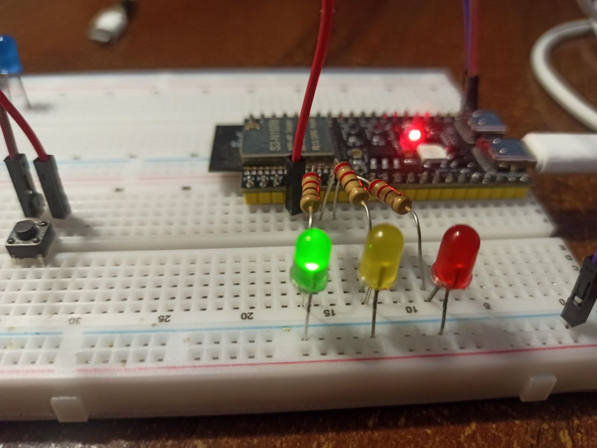
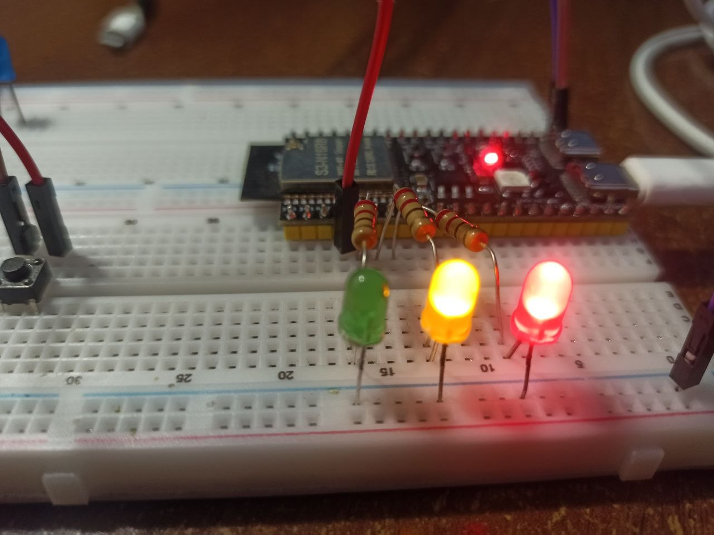

<h3><b>Mini Project 1.</b> Photoresistor + Relay module. </h3>

[[view source](MiniProject_1/src/main.cpp)]

A simple ESP32 project using a photoresistor to detect light. When it gets dark, the relay is activated and an LED turns on automatically.

  

EMA filtration with alpha = 0.2 :

  

<h3><b>Mini Project 2.</b> Traffic light. </h3>

[[view source](MiniProject_2/src/main.cpp)]

A simple ESP32 project simulating traffic lights, with user of timers, interrupts and debounce for button.

  
  

